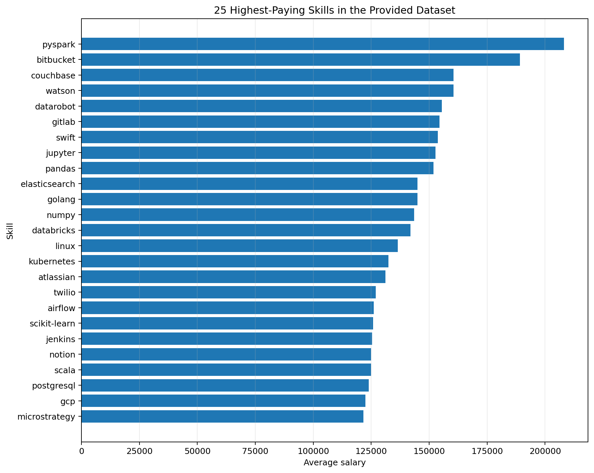

# Introduction
Diving into the data jobs market, this project covers:
the top paying jobs💵, in demand skills🔥, and where high demand skills meet the high paying skills 📈  
📌 SQL project queries you can check them here: [project_sql folder](/project_sql/).
# Background
This project is based on an SQL course project by Mr. Luke Barousse, with some modifications of my own. Thanks to Mr. Barousse for the course. You can find it here:
[Luke Barousse SQL Course](https://lukebarousse.com/sql).    
#### In this course project, Mr. Barousse explores the following questions 🔐  
NOTE ✏️: the role we focus on in this project is **Data Analyst**  
1. What are the top paying jobs for my role?  
2. What are the skills required for those top paying jobs?  
3. What are the most in demand skills for my role?  
4. What are the top paying skills for my role?  
5. What are the optimal skills to learn for my role?  
**Optimal** means skills that are both highly demanded and highly paid.  
# Tools I used
To explore this project in depth, I benefited from several tools 🛠️, including:  
- **SQL** as the main heart of this project realisation allowing us to query the database and to draw important insights.  
- **Postgres** the chosen database management system open source and ideal for ou project handling.
- **Visual Studio Code** as the bridge to executing the sql queries on the postgres database.  
- **Git & Github** the version control tools, ideal for sharing the project insight and analysis with tracking the changes and collaboration with others.  
- **Excel Charts & Power Query** they help clean and visualise some findings as charts.  
- **ChatGPT** this AI module helped to analyse some of the SQL queries execution results.
# The Analysis 
Each query in this project addresses one of the five questions listed in the **Background** section about the data analyst job market. Here's how I approached them:  
### 1. The Top-Paying Data Analyst Jobs  
In this section, I identify the 10 highest-paying remote Data Analyst job postings, exclude null average-salary values, and join `job_postings_fact` with `company_dim` to retrieve each company's name.
  
  
```SQL  
SELECT 
    job_id,
    job_title_short,
    job_location,
    job_schedule_type,
    salary_year_avg,
    name as company_name
FROM
    job_postings_fact
left join
    company_dim on job_postings_fact.company_id = company_dim.company_id
where 
    job_title_short='Data Analyst' AND
    salary_year_avg IS NOT NULL AND 
    job_location='Anywhere'
order by 
    salary_year_avg DESC
limit 10;     
```    
 
### 2. Skills Required for Top-Paying Data Analyst Jobs    
this query is a continuation of the previous query, it will return
the top 10 paying remot jobs for Data Analyst role .
with the skills required for those jobs.
here we're using the query 1 one to get The Top Paying Data Analyst Jobs as CTE's doing left join of job_posting_fact_table in this CTE's with the company_dim_table to return the job_title_short,salary_year_avg, from the job_posting_fact_table
and getting the company_name releated to each job offer .  
taking the result of this CTE's and matching each job_id to a set of skills names required for the job offer, to do this we've used the help of inner joining the skills_job_dim table and the skills_dim table with the top_paying CTE'S.
    skills as skill_name
  
```sql    
with top_paying AS( SELECT 
    *
FROM
    job_postings_fact
left join
    company_dim on job_postings_fact.company_id = company_dim.company_id
where 
    job_title_short='Data Analyst' AND
    salary_year_avg IS NOT NULL AND 
    job_location='Anywhere'
order by 
    salary_year_avg DESC
limit 10)
SELECT
    top_paying.job_id,
    job_title_short,
    salary_year_avg,
    name as company_name,
    skills as skill_name
FROM top_paying
INNER JOIN skills_job_dim ON top_paying.job_id=skills_job_dim.job_id
INNER JOIN skills_dim ON skills_job_dim.skill_id=skills_dim.skill_id
order by 
    salary_year_avg DESC
```    
#### Insights and Analysis  
1. **Big Findings:**
There is a very strong core skill hierarchy:
**SQL → Python → Tableau → R → Excel/Pandas/Snowflake**  
SQL is essentially a universal requirement in this sample.
Python is nearly universal as well.
That means if someone wants to maximize employability for these Data Analyst roles,
 the first priority should be:
SQL + Python + Tableau
rather than trying to learn all 28 skills.

2. **Domain Dominance:**
The market represented by this dataset is not looking for a narrow "Excel analyst."
It's looking for a hybrid Data Analyst who can work across:
**Data querying → programming → visualization → data platforms**
The dominant combination is therefore:
**Analytics + Programming + BI + Cloud**
rather than purely business/reporting skills.  

**you can see it clearly with the  chart visualisation below**  

  
*this chart explain the domanance of a set of skills in 8 different job posting offer (CHATGPT as a source).*  
  

  
### 3. The Most Demanded Skills for Data Analysts  
in this project we've used tow ways to get the top 5
skills most required  for Data Analyst jobs
that are remote based on the skills counting.  
by inner joing tree different tables, skills_job_dim with job_posting_fact then job_dim .   

**WAY 1: using CTE to get the top 5 skills**  
```sql
WITH skills_counting AS( SELECT 
   skill_id,
   COUNT(skills_job_dim.job_id) as skill_count
FROM 
    skills_job_dim
INNER JOIN 
    job_postings_fact ON 
    job_postings_fact.job_id=skills_job_dim.job_id
WHERE 
    job_title_short='Data Analyst' and job_work_from_home=TRUE
GROUP BY skill_id
)

SELECT
    skill_count,
    skills as skill_name
FROM skills_counting
INNER JOIN 
    skills_dim ON 
    skills_counting.skill_id=skills_dim.skill_id
ORDER BY skill_count DESC
limit 5;
```  
  
**WAY 2: using a single query to get the top 5 skills**  
```sql
SELECT 
    skills as skill_name,
    COUNT(skills_job_dim.job_id) as skill_count
FROM 
    skills_job_dim
INNER JOIN 
    job_postings_fact ON
    job_postings_fact.job_id=skills_job_dim.job_id
INNER JOIN 
    skills_dim ON 
    skills_job_dim.skill_id=skills_dim.skill_id
WHERE 
    job_title_short='Data Analyst' AND
    job_work_from_home=TRUE
group by 
    skills
order by 
    skill_count DESC
LIMIT 5;
```  
#### Insights and Analysis    
The table below is the query execution result
that shows the most 5 highly demanded skils for **Data Analyst roles** based on the skill mention count from each **Data Analyst** job offering:  
## Most In-Demand Skills

| Rank | Skill Name | Skill Count |
| ---: | ---------- | ----------: |
|    1 | SQL        |       7,291 |
|    2 | Excel      |       4,611 |
|    3 | Python     |       4,330 |
|    4 | Tableau    |       3,745 |
|    5 | Power BI   |       2,609 |
  
Based on this table, applicants targeting Data Analyst roles could prioritize these five skills: **SQL, Excel, Python, Tableau, and Power BI**, following the demand ranking.  
Tableau and Power BI overlap in their business-intelligence use cases, so a learner might choose one to start with depending on their goals. 
   
### 4. The Top-Paying Skills for Data Analyst Jobs 
this query  will return the top 25 skills that have 
the better paying chances for data analyst jobs.  
returning the skill name and ordering the results by the skill average salary using inteer joining of skills_job_dim table with job_posting_fact table then with skills_dim table.  
setting data analyst roles, remote jobs, and ignoring the salary average null values as the query conditions.  


  
```sql
SELECT 
    skills as skill_name,
    round(AVG(salary_year_avg),0) as avg_salary
FROM 
    skills_job_dim
INNER JOIN 
    job_postings_fact ON
    job_postings_fact.job_id=skills_job_dim.job_id
INNER JOIN 
    skills_dim ON 
    skills_job_dim.skill_id=skills_dim.skill_id
WHERE 
    job_title_short='Data Analyst' AND
    job_work_from_home=TRUE AND
    salary_year_avg IS NOT NULL
group by 
    SKILL_NAME
order by 
    avg_salary DESC
limit 25;  
```
#### Insights and Analysis
the following chart is the query execution result visualisation can better show case those 25 top paying skills for **Data Analys** roles:  

  
  
*Source: CHATGPT*  
##### Key Insights From The Chart:    
+ Specialist skills can be associated with more technical roles. PySpark, Databricks, Kubernetes, and similar technologies may appear in roles involving distributed computing, infrastructure, or complex data pipelines. Those roles can have different salary profiles from general analytics roles.
- For an intry level skill **Data Analyst** role it's highly recommended to go first with the most five demanded skills **(SQL,EXCEL,PYTHON,TABLEAU,POWER BI)** then when we want to swift gears into more paying roles we can follow with the 25 highly paying skills.  
  
### 5. The Optimal Set of Skills (High Demand and Pay)  
this query project will be a continuation of the query 3 and 4 
it's going to return the 25 optimal skills to learn , the gighly demanded and highly payed skills.  
by inner joining skills_job_dim table with job_posting_fact table  then with the skills_dim table using some Aggragation functions as the *COUNT(skills)* to count the skill demand and the *AVG(salary)* to determine the skill pay.  
setting data analyst roles, remote jobs, and ignoring the salary average null values as the query conditions. ordering the results by the skill salary and only taking the skills that thier count is biggar than 10. using tow solutions ways giving the same result.  
  
**WAY1: Using the 3th query(the highly demanded skills) and the 4th query(the highly paying skills) as tow different CTE's:**
  
```SQL
WITH most_demand AS (SELECT 
    skills as skill_name,
    COUNT(skills_job_dim.job_id) as skill_count
FROM 
    skills_job_dim
INNER JOIN 
    job_postings_fact ON
    job_postings_fact.job_id=skills_job_dim.job_id
INNER JOIN 
    skills_dim ON 
    skills_job_dim.skill_id=skills_dim.skill_id
WHERE 
    job_title_short='Data Analyst' AND
    job_work_from_home=TRUE AND
    salary_year_avg IS NOT NULL
group by 
    skills
), high_pay AS (SELECT 
    skills as skill_name,
    round(AVG(salary_year_avg),0) as avg_salary
FROM 
    skills_job_dim
INNER JOIN 
    job_postings_fact ON
    job_postings_fact.job_id=skills_job_dim.job_id
INNER JOIN 
    skills_dim ON 
    skills_job_dim.skill_id=skills_dim.skill_id
WHERE 
    job_title_short='Data Analyst' AND
    job_work_from_home=TRUE AND
    salary_year_avg IS NOT NULL
group by 
    skills

)

SELECT 
    most_demand.skill_name,
    skill_count,
    avg_salary
FROM
    most_demand
INNER JOIN high_pay 
ON most_demand.skill_name=high_pay.skill_name
WHERE
    skill_count > 10
order by 
    avg_salary DESC,
    skill_count DESC
LIMIT 25;
```  
  
**WAY 2: Using one simple query:**  
  
```sql
SELECT 
    --skills_job_dim.skill_id,
    skills as skill_name,
    COUNT(skills_job_dim.job_id) as skill_count,
    round(AVG(salary_year_avg),0) as skill_avg
FROM 
    skills_job_dim
INNER JOIN job_postings_fact 
ON   job_postings_fact.job_id=skills_job_dim.job_id  
INNER JOIN skills_dim
ON  skills_dim.skill_id=skills_job_dim.skill_id
WHERE 
    job_title_short='Data Analyst' AND
    job_work_from_home=TRUE AND
    salary_year_avg IS NOT NULL 
group by 
    skills_job_dim.skill_id,
    skills
HAVING COUNT(skills_job_dim.job_id) > 10
order by 
    skill_avg DESC,
    skill_count DESC;
```  
#### Insights and Analysis  
The scatter chart image below is a visualisation discription of the queries execution result:  
  
  

*NOOTE: I've made this results visualisation using Power Query and Excel built charts*  
  
**CHART INTERPRETATION:**

- From the **query 3 (5 highly demanded skills)** list Three of the five most demanded skills appear in the **25 highly demanded and payed skills** list, and they're **Python, Tableau And Power BI** while *SQL and Excel* do not.
That doesn't mean SQL and Excel are poorly paid in general. It means they did not qualify for this particular salary ranking.  
- None of the skills in Query 4's top-25 highest-paying list appears in the **high-demand, high-pay** list. This does not mean those skills are never in demand; in the data, they did not meet the optimal-list condition of a skill count **greater than 10**.   
  
# What I Learned:
Throughout this course-project journey, I worked through practical questions about the data job market. The project helped me learn:
- **How to constract comlex queries** using CTE's and tables joining it allow me pull specified useful data accross diffrent tables.
- **Data Aggregation** using GROUP BY to aggregate by unique values adding some of the aggregation functions like COUNT() and AVG() to do some mathimatical and stastical calculations.  
- **Analitical Skills Building** turining my reald world data questions into practical SQL queries to pull fruithfull results and use some other tools to better read them.   
- **Code Edditing & Collaboration Tools** using GIT, GITHUB and VS Code help to handle some basic Git commands to better build a solide reppo inside my Github. 
  
# Conclusion
For me, the most important part of this project is not just the findings, but the learning process. This was my first SQL project and my first GitHub README showcase. I feel ready to explore more real-world problems, combine what I have learned with other tools, and continue my data-analysis journey.


